# Roadmap y Seguimiento de Progreso — TomoToolNXPlus

Este documento es la fuente de verdad sobre la **meta principal**, la **secuencia de milestones (`M0`–`M8`)**, el **progreso actual** y el **inventario de capacidades** requerido por [la constitución del proyecto](../.specify/memory/constitution.md#ii-functional-borealis-adaptation-with-explicit-parity).

---

## Meta Principal (North Star Goal)

Reemplazar por completo el editor legacy en SDL ([`source/main.cpp`](../source/main.cpp), `TomoToolNXPlus.nro`) por la aplicación basada en **Borealis** ([`apps/borealis/`](../apps/borealis/), `TomoToolNXPlusBorealis.nro` → futuro `TomoToolNXPlus.nro`), garantizando:

1. **Integridad de guardado absoluta** ([`AGENTS.md`](../AGENTS.md#1-save-integrity-comes-first), [Constitución §I](../.specify/memory/constitution.md#i-save-integrity-before-all-other-goals)): backups verificados y aislados por usuario antes de cualquier mutación de partida, preservación de campos desconocidos o no relacionados, y recuperación explícita ante fallos parciales.
2. **Arquitectura desacoplada** ([`AGENTS.md`](../AGENTS.md#2-low-coupling-high-cohesion-clear-abstractions), [Constitución §III](../.specify/memory/constitution.md#iii-cohesive-modules-and-shared-application-rules) y [§IV](../.specify/memory/constitution.md#iv-incremental-improvement-of-existing-code)): lógica de dominio, parseo y validación compartida con WebUI y separada de Borealis, SDL y libnx, reduciendo [`source/main.cpp`](../source/main.cpp) incrementalmente hasta retirar la UI legacy.
3. **Modelo único de interacción** ([`AGENTS.md`](../AGENTS.md#4-ux-and-visual-quality), [Guía de UI](UI_GUIDELINES.md), [Constitución §V](../.specify/memory/constitution.md#v-one-predictable-controller-and-touch-model)): mando y pantalla táctil como métodos de primera clase (`ZL`/`ZR` para pestañas principales, `D-pad`/stick izquierdo para foco, `A` para activar/entrar, `B` para cancelar/volver, `Plus` para el menú Guardar/Salir y `Minus` reservado para el futuro menú contextual), sin introducir subpestañas nuevas.
4. **Evidencia verificable** ([`AGENTS.md`](../AGENTS.md#5-verification-and-completion), [Constitución §VI](../.specify/memory/constitution.md#vi-specifications-and-evidence-define-completion)): pruebas de regresión en host con fixtures sintéticos, compilación cruzada de los targets afectados (`make` y `make borealis`) y validación separada en emulador y consola Switch física.

---

## Estrategia del Camino: Lectura Primero → Compuerta de Backups → Escritura por Dominio

El orden acordado para avanzar hacia el reemplazo total sigue la regla **Lectura Primero en todas las pestañas de datos** (`Textures`, `Player`, `Mii`, `Map`) antes de habilitar escrituras de partidas en Borealis:

1. **Riesgo cero en la migración visual y de parseo (`M0`–`M3`)**: abrir la partida únicamente mediante `fsOpen_SaveDataReadOnly` (sin enlazar `SaveMount` ni escritores) permite extraer de [`source/main.cpp`](../source/main.cpp) los modelos de lectura, índices de `SaveEditor` y vistas de Borealis —incluido el canvas NanoVG del mapa— sin riesgo de dañar guardados reales.
2. **Validación temprana de UX en hardware real**: confirmar navegación, restauración de foco, layouts en tres idiomas (`en-US`, `es`, `es-419`), temas claro/oscuro y rendimiento en Switch física antes de introducir flujos de mutación.
3. **Compuerta única de integridad (`M4`)**: centralizar montaje escribible, validación previa a escritura, backups verificados por usuario y manejo de fallos de commit en un único hito antes de habilitar escrituras en `M5`–`M7`.

```mermaid
flowchart LR
    M0["M0: Base + Texturas (Solo Lectura)"] --> M1["M1: Player (Solo Lectura)"]
    M1 --> M2["M2: Mii (Solo Lectura)"]
    M2 --> M3["M3: Map NanoVG (Solo Lectura)"]
    M3 --> M4["M4: Compuerta de Backups e Integridad"]
    M4 --> M5["M5: Texturas (Escritura)"]
    M5 --> M6["M6: Player + Mii + ShareMii (Escritura)"]
    M6 --> M7["M7: Map + Bundles + Island Gen"]
    M7 --> M8["M8: WebUI/MTP + Retiro SDL (v2.0)"]
```

---

## Resumen de Progreso por Milestone

| Milestone | Spec | Nombre | Estado | Avance estimado |
| --- | --- | --- | --- | --- |
| **M0** | `001` | Base, Navegación Global y Texturas (Solo Lectura) | Completado (100% desarrollo + retest físico confirmado) | 100% |
| **M1** | `002` | Pestaña Player en Modo Solo Lectura (`Player.sav`) | Implementado en host y compilado (pendiente verificación física) | 85% |
| **M2** | `003` | Pestaña Mii en Modo Solo Lectura (`Mii.sav`) | Implementado en host y compilado (pendiente verificación física) | 85% |
| **M3** | `004` | Pestaña Map en Modo Solo Lectura y Vista NanoVG (`Map.sav`) | Pendiente | 0% |
| **M4** | `005` | Compuerta de Integridad: Backups, Restauración y Flujo de Guardado | Pendiente | 0% |
| **M5** | `006` | Operaciones Completas de Texturas (UGC Escritura/Importar/Exportar) | Pendiente | 0% |
| **M6** | `007` | Edición Validada de Player, Mii y ShareMii | Pendiente | 0% |
| **M7** | `008` | Edición de Mapa, Bundles e Island Generator | Pendiente | 0% |
| **M8** | `009` | Control de WebUI/MTP y Retiro del Editor SDL Legacy (`v2.0`) | Pendiente | 0% |

---

## Detalle de Milestones (`M0` a `M8`)

### M0 — Base, Navegación Global y Texturas (Solo Lectura) · *Estado: Completado*

- **Objetivo**: Consolidar el shell de Borealis, la política centralizada de navegación/footer, la selección nativa de perfil, las preferencias de textura (`v0.2.0`) y el navegador de texturas UGC reales en modo solo lectura ([`specs/001-browse-real-textures/`](../specs/001-browse-real-textures/spec.md)).
- **Alcance técnico y archivos clave**:
  - Shell, navegación y chrome global: [`apps/borealis/source/app.cpp`](../apps/borealis/source/app.cpp), [`apps/borealis/source/navigation.cpp`](../apps/borealis/source/navigation.cpp), [`apps/borealis/source/app_chrome.cpp`](../apps/borealis/source/app_chrome.cpp), [`apps/borealis/source/exit_menu.cpp`](../apps/borealis/source/exit_menu.cpp).
  - Identidad global con selector nativo de Switch: [`apps/borealis/source/profile_selector.cpp`](../apps/borealis/source/profile_selector.cpp), [`apps/borealis/source/profile_header.cpp`](../apps/borealis/source/profile_header.cpp).
  - Preferencias de textura con borradores y backup verificado de `/switch/TomoToolNX/config.ini`: [`apps/borealis/source/texture_settings_screen.cpp`](../apps/borealis/source/texture_settings_screen.cpp), [`source/texture_settings_store.cpp`](../source/texture_settings_store.cpp).
  - Navegador de texturas UGC solo lectura (`fsOpen_SaveDataReadOnly`): [`apps/borealis/source/texture_browser_screen.cpp`](../apps/borealis/source/texture_browser_screen.cpp), [`apps/borealis/source/texture_read_source.cpp`](../apps/borealis/source/texture_read_source.cpp), [`apps/borealis/source/texture_preview_view.cpp`](../apps/borealis/source/texture_preview_view.cpp), [`source/texture_decode.cpp`](../source/texture_decode.cpp), [`source/ugc_scanner.cpp`](../source/ugc_scanner.cpp), [`source/ugc_names.cpp`](../source/ugc_names.cpp).
  - Flujo de despliegue verificado por USB/DBI: [`docs/DEPLOY_SWITCH.md`](DEPLOY_SWITCH.md).
- **Criterios de salida / Verificación**:
  - **Desarrollo y host cerrados al 100%**: las 10 suites en `tests/run_texture_browser.sh` (incluyendo `tests/borealis_ui_screens_test.cpp` para control/táctil/ciclos/pestañas/ajustes/Plus sobre shim UI), las regresiones existentes y ambos builds (`make` y `make borealis`) están aprobados.
  - **Confirmación física en Switch (2026-11-19)**: desplegado con verificación SHA-256 por MTP; el usuario confirmó los flujos M0 y el espaciado proporcional corregido en acentos españoles tras promover `PlSharedFontType_Standard` en [`apps/borealis/source/navigation.cpp`](../apps/borealis/source/navigation.cpp) (ver [`docs/HARDWARE_UI_FEEDBACK.md`](HARDWARE_UI_FEEDBACK.md)).
  - **Notas formales separadas**: las mediciones cronometradas de latencia (`SC-005`) y recorridos exhaustivos por tema/dock/3 idiomas en [`specs/001-browse-real-textures/quickstart.md`](../specs/001-browse-real-textures/quickstart.md) quedan registradas como pendientes formales de matriz sin bloquear **M1**.

### M1 — Pestaña Player en Modo Solo Lectura (`Player.sav`) · *Estado: Implementado en host / Pendiente validación física (`002`)*

- **Objetivo**: Reemplazar los datos de muestra de la pestaña `Player` por lectura real de `Player.sav` para la cuenta seleccionada, sin capacidades de escritura ni montaje escribible ([`specs/002-browse-player-readonly/spec.md`](../specs/002-browse-player-readonly/spec.md)).
- **Documentación (`/speckit-plan` y `/speckit-tasks`)**: [`plan.md`](../specs/002-browse-player-readonly/plan.md), [`research.md`](../specs/002-browse-player-readonly/research.md), [`data-model.md`](../specs/002-browse-player-readonly/data-model.md), [`player-browser.md`](../specs/002-browse-player-readonly/contracts/player-browser.md), [`quickstart.md`](../specs/002-browse-player-readonly/quickstart.md) y [`tasks.md`](../specs/002-browse-player-readonly/tasks.md).
- **Alcance técnico implementado**:
  - Módulo puro de solo lectura [`include/player_profile.h`](../include/player_profile.h) y [`source/player_profile.cpp`](../source/player_profile.cpp): parseo acotado de los 15 atributos de `Player.sav`, soporte de `DT_WStr64` y `DT_WStr32` con pares sustitutos UTF-16LE completos, catálogos de moneda/región/idioma/tono/tamaño, deseos liberados contra [`include/wishes_data.h`](../include/wishes_data.h), reloj explícito para donación y controlador `PlayerBrowserModel`.
  - Pantalla inline [`apps/borealis/source/player_browser_screen.hpp`](../apps/borealis/source/player_browser_screen.hpp) / [`apps/borealis/source/player_browser_screen.cpp`](../apps/borealis/source/player_browser_screen.cpp) conectada en [`apps/borealis/source/app.cpp`](../apps/borealis/source/app.cpp) reutilizando [`apps/borealis/source/texture_read_source.cpp`](../apps/borealis/source/texture_read_source.cpp) (`fsOpen_SaveDataReadOnly`) y traducciones `en-US` / `es` / `es-419`.
- **Evidencia y pendientes**:
  - **Host y builds completos (`T001`–`T023`)**: aprobadas las 12 suites en `tests/run_texture_browser.sh` (normal y `SANITIZE=1 ASAN_OPTIONS=detect_leaks=0`), `make -j4`, `make -j4 borealis` y auditoría `aarch64-none-elf-nm -C` sin símbolos de escritura (`0` coincidencias).
  - **Pendiente en Switch físico (`T024`)**: despliegue vía DBI MTP y matriz visual/control/táctil en [`specs/002-browse-player-readonly/quickstart.md`](../specs/002-browse-player-readonly/quickstart.md).

### M2 — Pestaña Mii en Modo Solo Lectura (`Mii.sav`) · *Estado: Implementado en host / Pendiente validación física (`003`)*

- **Objetivo**: Reemplazar los datos de muestra de la pestaña `Mii` por la inspección real de los residentes en `Mii.sav` (hasta `MII_MAX_SLOTS = 70`), adaptando la navegación a la jerarquía de Borealis sin subpestañas ([`specs/003-browse-mii-readonly/spec.md`](../specs/003-browse-mii-readonly/spec.md)).
- **Documentación (`/speckit-plan` y `/speckit-tasks`)**: [`plan.md`](../specs/003-browse-mii-readonly/plan.md), [`research.md`](../specs/003-browse-mii-readonly/research.md), [`data-model.md`](../specs/003-browse-mii-readonly/data-model.md), [`mii-browser.md`](../specs/003-browse-mii-readonly/contracts/mii-browser.md), [`quickstart.md`](../specs/003-browse-mii-readonly/quickstart.md) y [`tasks.md`](../specs/003-browse-mii-readonly/tasks.md).
- **Alcance técnico implementado**:
  - Módulo puro de solo lectura [`include/mii_roster.h`](../include/mii_roster.h) y [`source/mii_roster.cpp`](../source/mii_roster.cpp): parseo acotado de `Mii.sav` y `Map.sav` opcional, detección segura de plazas ocupadas (`0..70`), decodificación UTF-16LE con pares sustitutos, 7 secciones (`Estadísticas`, `Palabras`, `Relaciones`, `Pertenencias`, `Hábitos`, `Vivienda` y `Resumen social`) reutilizando [`include/belongings_data.h`](../include/belongings_data.h), [`include/habits_data.h`](../include/habits_data.h) e [`include/rel_tier_labels.h`](../include/rel_tier_labels.h), y controlador `MiiBrowserModel`.
  - Jerarquía de 3 niveles sin subpestañas [`apps/borealis/source/mii_browser_screen.hpp`](../apps/borealis/source/mii_browser_screen.hpp) / [`apps/borealis/source/mii_browser_screen.cpp`](../apps/borealis/source/mii_browser_screen.cpp) (`MiiBrowserScreen` → `MiiDetailScreen` → `MiiSectionScreen`) conectada en la pestaña índice `2` de [`apps/borealis/source/app.cpp`](../apps/borealis/source/app.cpp), extendiendo `SwitchSource` (`fsOpen_SaveDataReadOnly`) para `"/Mii.sav"` y `"/Map.sav"` con traducciones en `en-US`, `es` y `es-419`.
- **Evidencia y pendientes**:
  - **Host y builds completos (`T001`–`T023`)**: aprobadas las 14 suites en `tests/run_texture_browser.sh` (normal y `SANITIZE=1 ASAN_OPTIONS=detect_leaks=0`), paridad i18n (`290` claves), `make -j4`, `make -j4 borealis` y auditoría `aarch64-none-elf-nm -C` sin símbolos de escritura (`0` coincidencias).
  - **Pendiente en Switch físico (`T024`)**: despliegue vía DBI MTP y matriz visual/control/táctil en [`specs/003-browse-mii-readonly/quickstart.md`](../specs/003-browse-mii-readonly/quickstart.md).

### M3 — Pestaña Map en Modo Solo Lectura y Vista NanoVG (`Map.sav`) · *Estado: Pendiente (`004`)*

- **Objetivo**: Reemplazar los datos de muestra de la pestaña `Map` por una visualización real de `Map.sav` con renderizado dedicado en NanoVG.
- **Alcance técnico y archivos clave**:
  - Extraer de [`source/main.cpp`](../source/main.cpp) el modelo de lectura de `Map.sav` ([`include/map_data.h`](../include/map_data.h), [`source/map_data.cpp`](../source/map_data.cpp)): cuadrícula de `120 × 80` celdas (`FloorKeyHash`), objetos/actores (`ActorKey`, `GridPosX`, `GridPosY`, `RotY`, footprints), vínculo de casas (`House.MapId`, `RoommateGroupName`) y residentes asignados desde `Mii.sav`.
  - Crear una `brls::View` dedicada con **NanoVG** (según [`docs/BOREALIS_MIGRATION.md`](BOREALIS_MIGRATION.md)) separando coordenadas del modelo respecto a píxeles de pantalla, con zoom, paneo por mando/arrastre táctil y panel de inspección de solo lectura para la celda o edificio seleccionado.
- **Criterios de salida / Verificación**:
  - Pruebas unitarias en host para coordenadas, hits de footprints con rotación, límites `120 × 80` y parsing acotado de `Map.sav`.
  - Validación visual y de interacción (zoom, arrastre táctil, foco del cursor, retorno desde detalle) en consola física.

### M4 — Compuerta de Integridad: Backups, Restauración y Flujo de Guardado · *Estado: Pendiente (`005`)*

- **Objetivo**: Construir y verificar la capa de aplicación que gobierna el montaje escribible, la creación/verificación de backups por usuario, la restauración y el commit seguro antes de habilitar cualquier edición en Borealis.
- **Alcance técnico y archivos clave**:
  - Auditar e integrar [`source/backup.cpp`](../source/backup.cpp), [`source/backup_snapshot.cpp`](../source/backup_snapshot.cpp), [`source/save_mount.cpp`](../source/save_mount.cpp), [`source/save_workflow.cpp`](../source/save_workflow.cpp) y [`source/save_editor.cpp`](../source/save_editor.cpp) (`ValidateForWrite`), eliminando dependencia de globals SDL.
  - Implementar UI de Borealis para: aviso de seguridad al habilitar escritura, creación de backup verificado antes de mutar, selector de restauración por usuario (`UserPick` / `RestorePicker` equivalente), política de bloqueo si el backup falla y mensajes de recuperación ante fallos de escritura o commit ([`docs/SAVE_RECOVERY.md`](SAVE_RECOVERY.md)).
  - Regla de compuerta: **ningún milestone `M5`–`M7` puede escribir en `Player.sav`, `Mii.sav`, `Map.sav` ni `Ugc/` sin pasar por este servicio.**
- **Criterios de salida / Verificación**:
  - Pruebas en host con fallos inyectados de backup, espacio/slots llenos, escritura corta y error de commit verificando que la partida destino no se corrompe y el backup permanece íntegro e aislado por usuario.
  - Validación en Switch física con una cuenta de prueba verificando backup y restauración reales.

### M5 — Operaciones Completas de Texturas (UGC Escritura, Importación y Exportación) · *Estado: Pendiente (`006`)*

- **Objetivo**: Alcanzar paridad funcional completa de la pestaña `Textures` en Borealis usando la compuerta `M4` y las preferencias `TextureSettings`.
- **Alcance técnico y archivos clave**:
  - Conectar con [`source/texture_processor.cpp`](../source/texture_processor.cpp) y [`source/mii_manager.cpp`](../source/mii_manager.cpp) a través de servicios compartidos: importar PNG (aplicando shape/encoder/BC1/fit/matte desde `ConfigStore`), importar/exportar `.ltdx`, crear slot UGC en blanco (`CreateBlankUgc`), eliminar slot (`DeleteUgc`), renombrar en `Player.sav` (`RenameUgc`), selector de tipo `kind`, explorador de archivos en SD y eliminación de fondo IA ([`source/u2net_infer.cpp`](../source/u2net_infer.cpp)) con progreso real no bloqueante.
- **Criterios de salida / Verificación**:
  - Pruebas de round-trip en host (importar/renombrar/borrar preservando datos no relacionados de `Player.sav`), compilación de ambos targets y pruebas de importación/exportación verificadas en el juego en Switch física.

### M6 — Edición Validada de Player, Mii y ShareMii · *Estado: Pendiente (`007`)*

- **Objetivo**: Alcanzar paridad funcional de edición en `Player` y `Mii` (incluyendo **ShareMii**) mediante borradores explícitos, validación compartida con WebUI y commits protegidos por `M4`.
- **Alcance técnico y archivos clave**:
  - **Player**: teclado nativo `swkbd` para nombre/isla/pronunciación y dinero; selectores validados para moneda, región, idioma, tono de piel y tamaño de isla; limpieza de penalización Time-Travel; ajuste de donación y acciones masivas de deseos (con confirmación explícita y accesibles por foco/táctil, corrigiendo acciones solo-táctiles del legacy).
  - **Mii**: edición de estadísticas, palabras, relaciones individuales y acciones por lotes (*Know* / *Boost* / *Zero*), pertenencias/atuendos/bolsillo, hábitos, vivienda, crear/borrar Mii, importar/exportar `.ltd` y cliente **ShareMii** ([`include/share_client.h`](../include/share_client.h), [`source/share_client.cpp`](../source/share_client.cpp)).
- **Criterios de salida / Verificación**:
  - Pruebas de regresión de validación, rangos y preservación de campos desconocidos en `Player.sav` y `Mii.sav`; pruebas en Switch física de extremo a extremo con carga posterior en Tomodachi Life.

### M7 — Edición de Mapa, Bundles e Island Generator · *Estado: Pendiente (`008`)*

- **Objetivo**: Alcanzar paridad funcional de edición en `Map` y migrar la creación/aplicación de bundles y el **Island Generator** en consola.
- **Alcance técnico y archivos clave**:
  - **Map**: herramientas de pintura de terreno sobre la vista NanoVG (selector de tiles, grosores de pincel, cuentagotas), colocación/movimiento/rotación/vínculo de objetos y casas, historial Undo/Redo y exportación de mapa a PNG.
  - **Bundles e Island Generator**: extraer de [`source/main.cpp`](../source/main.cpp) los flujos de arranque sin partida / `BundleCreate` / `BundleApply` y conectar [`include/island_generator.h`](../include/island_generator.h), [`source/island_generator.cpp`](../source/island_generator.cpp), [`include/island_generator_runner.h`](../include/island_generator_runner.h), [`source/island_generator_runner.cpp`](../source/island_generator_runner.cpp) a pantallas Borealis con progreso real y cancelación segura.
- **Criterios de salida / Verificación**:
  - Regresiones en host de Undo/Redo y reglas de footprint/colocación; verificación de generación/bundles y carga en consola física.

### M8 — Control de WebUI / MTP y Retiro del Editor SDL Legacy (`v2.0`) · *Estado: Pendiente (`009`)*

- **Objetivo**: Migrar el ciclo de vida de `HttpServer` y `MtpServer` a la pestaña `WebUI` de Borealis, cerrar el 100% del inventario de capacidades y retirar el editor SDL legacy.
- **Alcance técnico y archivos clave**:
  - **WebUI y MTP**: integrar [`include/http_server.h`](../include/http_server.h), [`source/http_server.cpp`](../source/http_server.cpp), [`source/qr_svg.cpp`](../source/qr_svg.cpp), [`include/mtp_server.h`](../include/mtp_server.h) y [`source/mtp_server.cpp`](../source/mtp_server.cpp) en la pestaña `WebUI` de Borealis (control de inicio/parada, prevención de suspensión opcional, QR/URL, registro de actividad, advertencia única de MTP en emulador y drenado seguro en el hilo principal de `ImportJob`, `BgRemoveJob` y recargas de `.sav`).
  - **Retiro del legacy**: auditar cualquier función pendiente de `source/main.cpp` (tema del sistema Borealis, actualización/aviso de applet, idioma), promover el binario Borealis como el entregable principal `TomoToolNXPlus.nro` y retirar el renderizador/bucle SDL legacy.
- **Criterios de salida / Verificación**:
  - Inventario de capacidades al 100% sin brechas sin justificación, regresiones completas de host, compilación final y aceptación completa en hardware Switch físico (mando, táctil, SD, WebUI, MTP y partidas reales).

---

## Inventario de Capacidades y Matriz de Paridad

Este inventario rastrea cada flujo existente en el editor SDL legacy ([`source/main.cpp`](../source/main.cpp)) frente a su estado actual en Borealis ([`apps/borealis/`](../apps/borealis/)):

| Dominio / Capacidad Legacy | Estado en Borealis | Milestone | Evidencia actual |
| --- | --- | --- | --- |
| Selección de perfil Switch y cambio en sesión | **Migrado** (selector nativo en arranque y header global) | `M0` | Host + retest físico confirmado ([record](HARDWARE_UI_FEEDBACK.md)) |
| Navegación global (`ZL`/`ZR`, `D-pad`, `A`, `B`, táctil, `Plus` Guardar/Salir) | **Migrado** (política centralizada y footer propio) | `M0` | Host + retest físico confirmado ([record](HARDWARE_UI_FEEDBACK.md)) |
| Preferencias de textura (`config.ini` con draft y backup verificado) | **Migrado (v0.2.0)** | `M0` | Host + emulador adaptado; pendiente SD física ([record](BOREALIS_MIGRATION.md#verification-of-v020)) |
| Texturas: listar slots UGC reales, nombres en `Player.sav` y vista previa | **Migrado (Solo Lectura)** | `M0` | Host (10 suites) + confirmación física M0 y fuente (`2026-11-19`); matriz formal en [quickstart](../specs/001-browse-real-textures/quickstart.md) |
| Player: consultar los 15 campos de `Player.sav` y deseos liberados | **Migrado (Solo Lectura)** | `M1` | Host (12 suites + ASan/UBSan) + `make`/`make borealis` + `nm` ELF audit; pendiente Switch físico ([quickstart](../specs/002-browse-player-readonly/quickstart.md)) |
| Mii: listar hasta 70 residentes y consultar stats, palabras, relaciones, pertenencias, hábitos, vivienda y social | Muestra ficticia | `M2` | — |
| Map: visualizar cuadrícula `120 × 80`, objetos, casas y detalles en NanoVG | Muestra ficticia | `M3` | — |
| Backups por usuario, restauración (`RestorePicker`), montaje escribible y commit seguro | Ausente (no enlazado a propósito) | `M4` | — |
| Texturas: importar PNG/`.ltdx`, exportar `.ltdx`, crear blanco, borrar, renombrar, file browser SD y quitar fondo (U2Net) | Ausente | `M5` | — |
| Player: editar campos (`swkbd`, moneda, región, idioma, tono, tamaño, TT penalty, donación y deseos en lote) | Ausente | `M6` | — |
| Mii: editar stats/palabras/relaciones/ropa/hábitos/vivienda, crear/borrar Mii, `.ltd` y ShareMii online | Ausente | `M6` | — |
| Map: pintar terreno, colocar/mover/rotar objetos, Undo/Redo, exportar PNG | Ausente | `M7` | — |
| Bundles (`BundleCreate`/`BundleApply`) e Island Generator en consola | Ausente | `M7` | — |
| Pestaña WebUI (HTTP server, QR, log, cola de trabajos) y MTP USB | Solo botón Guardar/Salir en tab `WebUI` | `M8` | — |
| Verificador de actualizaciones / advertencia Applet / retiro de SDL en `source/main.cpp` | Pendiente de disposición/migración | `M8` | — |

---

## Reglas de Mantenimiento del Progreso

Para que el progreso sea siempre visible y verificable:

1. **Trazabilidad Spec → Milestone**: cada nueva especificación en `specs/00X-...` debe indicar en su cabecera a qué milestone (`M1`–`M8`) corresponde.
2. **Actualización al avanzar o cerrar un hito**: cuando una feature cambie de estado (por ejemplo, al aprobar su spec, plan, implementación o verificación física), se debe actualizar la tabla de **Resumen de Progreso**, el estado del milestone correspondiente y el **Inventario de Capacidades** en este archivo.
3. **Respetar las evidencias reales**: ningún milestone ni capacidad se marca como completo únicamente por compilar o por pasar pruebas en host; las casillas de hardware solo se cierran cuando existe evidencia explícita documentada (como en [`docs/HARDWARE_UI_FEEDBACK.md`](HARDWARE_UI_FEEDBACK.md) y [`specs/001-browse-real-textures/quickstart.md`](../specs/001-browse-real-textures/quickstart.md)).
