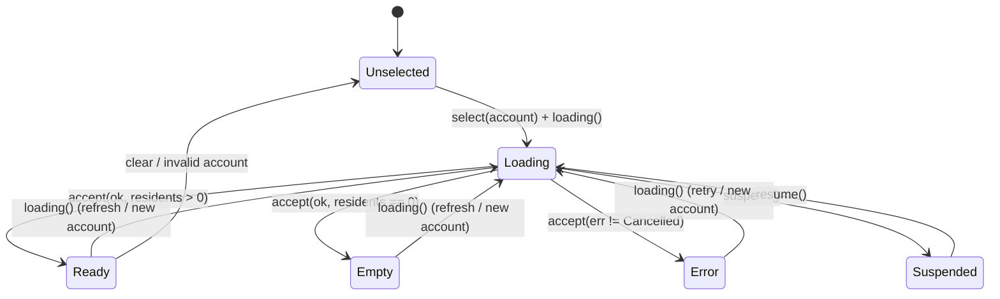

# Data Model: Consulta de residentes Mii en modo solo lectura (M2)

**Feature**: `specs/003-browse-mii-readonly/` (`M2`) | **Date**: 2026-11-22

Todas las estructuras viven en el espacio de nombres `MiiRoster` ([include/mii_roster.h](../../include/mii_roster.h)) sin dependencias de Borealis, SDL, HTTP ni `libnx`. Ninguna entidad expone mutadores de guardado ni rutas de escritura.

---

## 1. Constantes y enumeraciones de sección

```cpp
constexpr size_t MaxSlots = 70;
constexpr size_t WordsPerMii = 12;
constexpr size_t PocketSlotsPerMii = 12;
constexpr size_t WornClothSlots = 8;
constexpr size_t HabitCategoryCount = 9;
constexpr size_t MaxArrayCount = 65536;

enum class MiiSectionId : size_t {
    Stats = 0,
    Words,
    Relations,
    Belongings,
    Habits,
    Housing,
    Social,
};
constexpr size_t SectionCount = 7;
```

---

## 2. Entidades de dominio de residente (`MiiResident`)

### `MiiStats` (16 atributos de solo lectura)
| Campo | Tipo | Origen / Validación |
| --- | --- | --- |
| `name` / `nameTextWarning` | `std::string` / `bool` | `Mii.Name.Name[idx]` (`WStr32Array`, UTF-16LE con pares sustitutos) |
| `levelRaw` / `levelPresent` | `int32_t` / `bool` | `Mii.MiiMisc.SatisfyInfo.Level[idx]` (mostrado como `levelRaw + 1`) |
| `levelMeter` / `levelMeterPresent` | `int32_t` / `bool` | `Mii.MiiMisc.SatisfyInfo.Meter[idx]` (rango esperado `0..100`) |
| `money` / `moneyPresent` | `uint32_t` / `bool` | `Mii.Belongings.Money[idx]` (`UIntArray`) |
| `bdayDay`, `bdayMonth`, `bdayYear`, `directAge` (+ flags `*Present`) | `int32_t` / `bool` | `Mii.MiiMisc.BirthdayInfo.{Day,Month,Year,DirectAge}[idx]` (`1..31`, `1..12`, `directAge == -1` → automático) |
| `activeness`, `audacity`, `commonsense`, `gaiety`, `sociability` (+ flags `*Present`) | `int32_t` / `bool` | `Mii.CharacterParam.*` (rango esperado `1..10`) |
| `bondMeter` / `bondMeterPresent` | `int32_t` / `bool` | `Mii.MiiMisc.BondInfo.Meter[idx]` (rango esperado `0..100`) |
| `moodHash` / `moodPresent` / `moodKnown` / `moodKey` | `uint32_t` / `bool` / `std::string` | `Mii.Feeling.Type[idx]` (`9` estados conocidos; desconocido → hex `0xXXXXXXXX` + warning) |
| `fullness` / `fullnessPresent` | `int32_t` / `bool` | `Mii.MiiMisc.EatInfo.EatFullness[idx]` (puede superar `100`) |

### `MiiWordSlot` (12 plazas por residente)
- `slotNumber` (`1..12`), `kindHash` (`uint32_t`), `isEmpty` (`kindHash == Hash("Invalid")` o ausente), `kindKnown` (`bool`), `kindKey` (`std::string`), `text`, `howToCall` (`std::string`), `textWarning` (`bool`).

### `MiiRelationEntry` (vínculos hacia otros residentes)
- `pairIndex` (`int`), `otherSlotIndex` (`int`, `0..69`), `otherSlotNumber` (`1..70`), `otherName` (`std::string`), `otherSlotOccupied` (`bool`).
- `myTypeHash`, `otherTypeHash` (`uint32_t`), `myTypeKnown` (`bool`), `myTypeKey` (`std::string`), `categoryGroup` (`Friend`, `Romance`, `Family`, `Know`, `Former`, `Other`).
- `meter` (`int32_t`), `meterFixed` (`bool`, true para `Unknown`/`Invalid`), `tierLabel` (`std::string`, resuelto desde `rel_tier_labels.h` según tipo, medidor e `isFight`), `isFight` (`bool`), `sinceUnixSeconds` (`uint64_t`).

### `MiiBelongings` (8 prendas + conjunto Coordinate + 12 bolsillos)
- `wornSlots[8]`: `slotKey` (`All`, `Topslong`, `Tops`, `BottomsA`, `BottomsB`, `Headwear`, `Shoes`, `Accessory`), `itemHash`, `colorIndex`, `colorCount`, `isEmpty`, `known`, `label`.
- `coordinate`: `itemHash`, `colorIndex`, `colorCount`, `isEmpty`, `known`, `label` (cuando no está vacío indica que sustituye las prendas individuales).
- `pocket[12]`: `slotNumber` (`1..12`), `itemHash`, `isEmpty`, `known`, `label`.

### `MiiHabitEntry` y `MiiHabitCategorySummary` (74 hábitos en 9 categorías)
- `MiiHabitEntry`: `habitIndex` (`0..73`), `category` (`0..8`), `label` (`const char*` de `HABITS`), `isOwn` (`bool`), `isChecked` (`bool`), `stateHash` (`uint32_t`), `state` (`Owned`, `Unowned`, `NeverOwned`, `Unknown`).
- `MiiHabitCategorySummary`: `category` (`0..8`), `categoryKey`, `ownedCount`, `activeCount`, `totalCount`, `entries` (`std::vector<MiiHabitEntry>`).

### `MiiHousingInfo`
- `housed` (`bool`: `houseMapId >= 0`), `houseMapId` (`int32_t`), `roomIndex` (`int32_t`), `houseName` (`std::string`, resuelto desde `Map.sav` o vacío para usar reserva `"Casa #N"`), `houseNameFromMap` (`bool`).
- `housemates` (`std::vector<MiiHousemateRef>`: `slotNumber`, `name`, `roomIndex`, `sameRoomConflict`).
- `hasRoomConflict` (`bool`: existe otro residente ocupado con el mismo `(houseMapId, roomIndex)`).

### `MiiSocialSummary`
- `totalConnections` (`size_t`), conteos por grupo (`friends`, `romance`, `family`, `know`, `former`, `other`), conteo de peleas activas (`activeFights`) y lista de `MiiRelationEntry` ordenada por grupo y medidor descendente.

### `MiiResident` y `MiiRosterSummary`
- `MiiResident`: `slotIndex` (`0..69`), `slotNumber` (`1..70`), `stats`, `words` (`std::array<MiiWordSlot, 12>`), `relations`, `belongings`, `habitCategories` (`std::array<MiiHabitCategorySummary, 9>`), `housing`, `social`, `hasWarnings` (`bool`).
- `MiiRosterSummary`: `saveVersion` (`uint32_t`), `residents` (`std::vector<MiiResident>`, `0..70` elementos ordenados por `slotNumber` ascendente), `mapNamesAvailable` (`bool`), `mapNamesWarning` (`bool`), `hasFieldWarnings` (`bool`).

---

## 3. Errores tipados (`MiiReadError`) y resultados

```cpp
enum class MiiReadError {
    None = 0,
    NoAccountSelected,
    NoSave,
    AccountMetadataFailed,
    ReadOnlyOpenFailed,
    ShortRead,
    FileTooLarge,
    InvalidHeader,
    CorruptIndex,
    TruncatedPayload,
    MissingRequiredField,
    TypeMismatch,
    Cancelled,
};
```

- **Nota**: Una isla válida con `0` residentes ocupados **NO** es error; devuelve `Status{None}` con `summary.residents.empty() == true`, y `MiiBrowserModel` transiciona a `MiiBrowserState::Empty`.

---

## 4. Máquina de estados (`MiiBrowserModel`)



### `MiiBrowserContext`
- `TextureBrowser::Account account`
- `int selectedSlotNumber = -1` (plaza `1..70` del residente enfocado/abierto)
- `std::string focusTarget = "refresh"` (`"refresh"`, `"tabs"`, o `"mii_<slotNumber>"`)
- `float scroll = 0.0f`
- `uint64_t generation = 0` (incrementado en cada `select`, `loading` o `suspend` para descartar entregas obsoletas)
